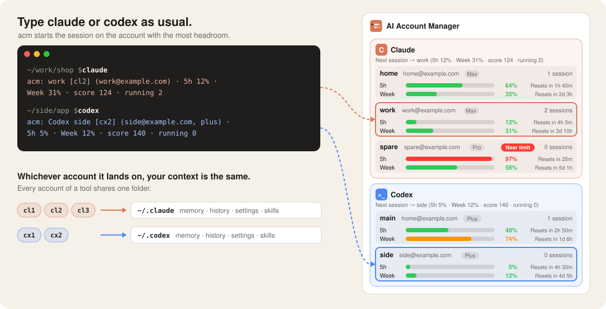

# ai-account-manager

[English](README.md) | 한국어

Claude Code 나 Codex 구독을 여러 개 가져도 계정들은 서로 따로 논다. 세션은 마지막으로 로그인한 계정으로 뜨므로 한 계정이 한도에 닿는 동안 다른 계정은 쓰이지 않고 남는다. 메모리와 히스토리, 설정, 스킬도 계정마다 따로라서 다른 계정으로 옮기면 빈 맥락에서 다시 시작해야 한다.

acm 은 이 계정들을 하나처럼 쓰게 하는 런처다. `claude` 와 `codex` 를 평소대로 치면 acm 이 그 도구의 계정 가운데 남은 여유가 가장 큰 계정으로 세션을 띄운다. 모든 계정이 같은 `~/.claude` 나 `~/.codex` 를 읽어서 어느 계정으로 떠도 하던 일의 맥락이 따라온다.



## acm 이 하는 일

acm 은 세션을 띄울 때마다 계정을 고른다. 5시간 한도의 여유와 주간 한도를 쓰는 속도를 함께 따져서, 리셋 때 쓰지 못하고 사라질 몫이 많은 계정부터 쓴다. 한도에 가까운 계정은 고르지 않는다. 점수가 비슷한 계정끼리는 떠 있는 세션이 적은 쪽을 고른다. 기준은 [계정 배정과 사용량](docs/selection.md) 에 있다.

한 도구의 모든 계정은 맥락 하나를 같이 쓴다. 메모리와 히스토리, 설정, 스킬은 `~/.claude` 나 `~/.codex` 한 곳에 있다. 계정 폴더는 링크로 그곳을 가리킨다. 한도에 걸려 멈춘 Claude 세션은 `acm resume` 으로 다른 계정에서 이어 간다. Codex 세션은 `acm codex resume` 으로 어느 Codex 계정에서든 연다.

메뉴바 창에서 모든 계정의 5시간 사용량과 주간 사용량, 리셋까지 남은 시간을 본다. 떠 있는 위젯은 같은 숫자를 화면에 늘 띄워 둔다. 터미널에서는 `acm status` 가 같은 내용을 보여 준다. Antigravity CLI `agy` 가 깔려 있으면 그 주간 사용량도 함께 보이지만, acm 이 agy 를 띄우거나 고르지는 않는다.

Claude 아티팩트는 대표 계정 하나에 모을 수 있다. 아티팩트는 발행한 계정의 것이라서 고치거나 지우는 일도 그 계정에서만 된다. 아티팩트 모으기를 켜면 다른 계정 세션이 아티팩트를 대표 계정의 발행 세션에 넘기므로 모든 아티팩트를 한 곳에서 관리한다.

acm 은 로그인 토큰을 읽지도 옮기지도 않는다. 로그인은 계정마다 Claude Code 와 Codex 가 자기 로그인 흐름으로 한다. 사용량은 statusline 과, 그 계정으로 돌린 `claude -p /usage` 와 `codex app-server` 에서 읽는다.

## 비슷한 도구와 무엇이 다른가

같은 문제의 일부를 푸는 도구가 이미 있다. 아래 설명은 2026년 11월 기준 각 프로젝트의 문서를 따랐다.

| 도구 | 하는 일 | acm 과 다른 점 |
|---|---|---|
| [claude-swap](https://github.com/realiti4/claude-swap) | 저장해 둔 인증 정보를 바꿔 끼워 Claude Code 에 로그인한 계정을 바꾼다. 사용량이 기준을 넘으면 자동으로 다음 계정으로 넘긴다. 대화 히스토리는 따로 켜지 않으면 계정마다 따로 둔다. macOS 와 Linux, Windows 에서 돈다 | acm 은 인증 정보를 옮기지 않는다. 모든 계정이 자기 폴더에 로그인한 채로 있다. 히스토리는 처음부터 같이 쓰고 Codex 계정도 다룬다. 다만 acm 은 아직 macOS 에서만 돈다 |
| [CCS 계정 풀](https://docs.ccs.kaitran.ca/features/pool) | 로컬 프록시 뒤에 Claude 계정 여러 개를 묶어 두고 한 계정을 다 쓴 뒤에 다음 계정으로 넘어간다 | acm 은 프록시 없이 세션을 계정 하나에 바로 띄운다. 계정을 순서대로 쓰지 않고 여유에 따라 나눠 쓴다 |
| [claude-limits](https://github.com/figueiredouc/claude-limits) | Claude Code 의 토큰으로 사용량 API 를 불러 macOS 메뉴바에 사용량을 보인다 | acm 은 Claude 와 Codex 의 모든 계정을 창 하나에 보인다. 사용량은 토큰을 건드리지 않고 읽는다 |

## 빠른 시작

지금은 macOS 에서만 돈다. Linux 와 Windows 지원은 [플랫폼 지원 계획](docs/platforms.md) 에 적어 두었다. `python3` 와 `jq`, `claude` 가 있어야 하고 Codex 계정을 쓰려면 `codex` 도 있어야 한다. 메뉴바 앱은 `swiftc` 로 빌드하며 Apple silicon 의 macOS 14 이상에서 돈다.

1. JetBrains IDE 와 떠 있는 claude 세션을 모두 닫는다. 떠 있으면 setup 이 IDE 플러그인 설정과 공유 폴더를 남은 일로 미룬다.
2. 저장소를 받아 `install.sh` 를 돌린다. CLI 와 statusline 래퍼, 메뉴바 앱을 깐 뒤 `acm setup` 을 부른다.

   ```bash
   git clone https://github.com/dodokim-lab/ai-account-manager.git
   cd ai-account-manager
   ./install.sh
   ```

3. setup 이 계정을 추가할지 물으면 추가하고 그 계정으로 로그인한다. 지금 쓰는 `~/.claude` 는 그대로 첫 계정 `cl1` 이 된다.
4. 새 터미널을 열고 `claude` 를 친다. 남은 여유가 가장 큰 Claude 계정으로 뜬다.
5. `acm status` 로 계정마다 로그인과 사용량을 확인한다.

## 자세히 쓰려면

[사용 안내](GUIDE.md) 에 Claude 와 Codex 계정 더하기, 세션 띄우기, 아티팩트 모으기, Claude Code 업데이트 뒤 점검, 제거, 문제 해결을 절마다 하나씩 적었다. 사용 안내와 아래 문서는 영어로 쓰여 있다.

| 문서 | 다루는 것 |
|---|---|
| [설치와 처음 설정](docs/setup.md) | `acm setup` 이 바꾸는 것, 셸 함수, IDE 에서 띄우기 |
| [계정 관리](docs/accounts.md) | 계정 폴더 구성, 공유 폴더, 로그인 토큰 갱신, Codex 계정 |
| [계정 배정과 사용량](docs/selection.md) | 배정 기준과 환경변수, 사용량 수집, Ultra 계정, Codex 사용량, Antigravity 사용량 |
| [아티팩트 모으기와 화면 제어](docs/publisher.md) | 발행 세션과 승인 범위, 대표 계정 여유, aside |
| [메뉴바와 위젯](docs/app.md) | 메뉴바 창의 도구별 계정 카드, 떠 있는 위젯 |
| [플랫폼 지원 계획](docs/platforms.md) | Linux 와 Claude Desktop, Windows 를 이 순서로 지원하는 데 필요한 일 |
| [나중에 할 것](docs/roadmap.md) | 미뤄 둔 기능과 그 이유 |

## 본인 계정에만 쓴다

acm 은 Anthropic 이나 OpenAI 와 관계없는 비공식 도구다. Anthropic 은 [구독 요금제의 사용 한도가 평범한 개인 사용을 전제한다](https://code.claude.com/docs/en/legal-and-compliance)고 적고 있다. acm 은 구독을 여러 개 가진 한 사람이 쓰려고 만든 도구라서 여러 사람이 계정을 나눠 쓰는 데는 쓰지 않는다.

## 기여하거나 취약점을 알리려면

PR 을 올리기 전에 돌릴 검사와 지킬 규칙은 [CONTRIBUTING.md](CONTRIBUTING.md) 에 영어로 있다. 보안 취약점은 공개 이슈 대신 [SECURITY.md](SECURITY.md) 에 적힌 대로 비공개로 신고한다.

## 라이선스

MIT 라이선스로 배포한다. 전문은 `LICENSE` 파일에 있다.
